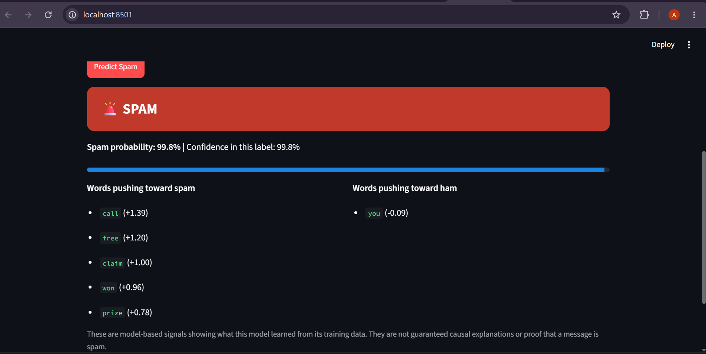
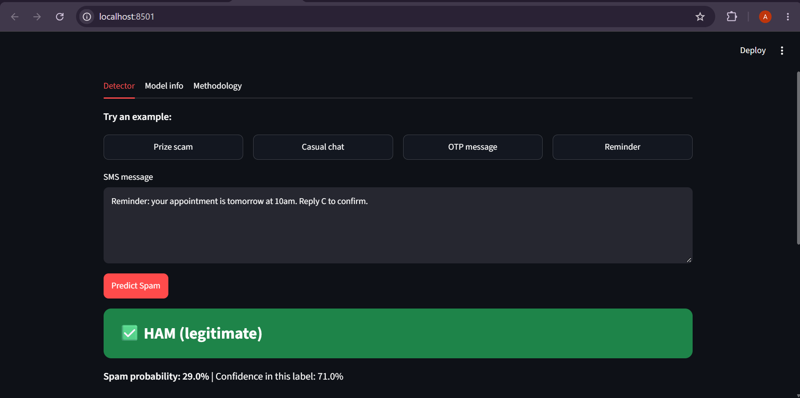
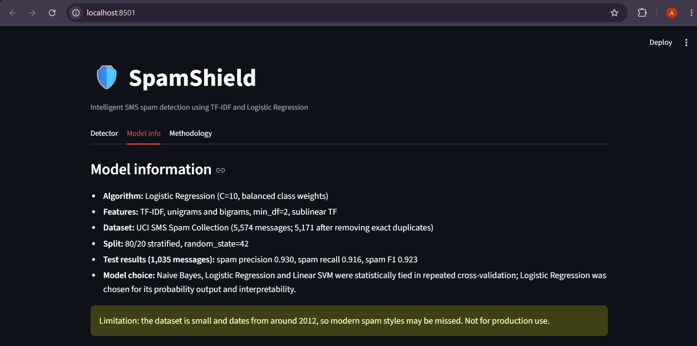

# 🛡️ SpamShield: SMS Spam Detection with Machine Learning and NLP

An end-to-end machine learning project that classifies SMS messages as **spam** or **ham** (legitimate), with a Streamlit web app that shows a probability and the words that influenced each prediction.

**Live demo:** https://spamshield-74s7q9chfxsmkdptqewvuo.streamlit.app/

## Problem statement
Spam SMS wastes time and can be used for phishing. The goal is to build a reproducible, honestly evaluated classifier, covering data checks, preprocessing, model comparison, tuning, testing and deployment.

## Features
- Text preprocessing that keeps spam signals (digits, punctuation) and maps URLs and number placeholders to tokens
- Comparison of Multinomial Naive Bayes, Logistic Regression and Linear SVM
- Hyperparameter tuning with stratified cross-validation on training data only
- Spam probability with a confidence bar and per-word influence display
- 14 automated tests (pytest)
- Error handling for empty input and a missing model file

## Technology stack
Python 3.13, pandas, NumPy, scikit-learn, matplotlib, seaborn, joblib, Streamlit, pytest.

## Dataset
[UCI SMS Spam Collection](https://archive.ics.uci.edu/dataset/228/sms+spam+collection) (Almeida and Hidalgo, 2011): 5,574 messages, 747 spam (13.4%). Exact duplicates (403) were removed **before** splitting, leaving 5,171 messages (653 spam, 12.6%). The data file is not included in this repository.

## Installation
```bash
git clone https://github.com/anndeljo-hub/SpamShield.git
cd SpamShield
python -m venv venv
venv\Scripts\activate          # Windows (macOS/Linux: source venv/bin/activate)
pip install -r requirements.txt
```
Download the dataset from the link above and place the file named `SMSSpamCollection` in `data/`.

## Usage
```bash
python -m src.eda            # exploratory analysis, charts in reports/figures/
python -m src.train_compare  # compare three models
python -m src.tune           # hyperparameter tuning
python -m src.evaluate       # repeated CV, ROC-AUC, PR curves
python -m src.train          # train final model -> models/spam_detector.pkl
python -m pytest -v          # run tests
python -m streamlit run app.py
```

## Results
Held-out test set: 1,035 messages (131 spam), stratified 80/20 split, `random_state=42`.

| Model (tuned) | Spam precision | Spam recall | Spam F1 | Repeated-CV F1 (train only) |
|---|---|---|---|---|
| Multinomial NB | 0.961 | 0.939 | 0.950 | 0.943 ± 0.017 |
| Logistic Regression | 0.930 | 0.916 | 0.923 | 0.944 ± 0.015 |
| Linear SVM | 0.945 | 0.916 | 0.930 | 0.947 ± 0.013 |

ROC-AUC on the test set is about 0.993 for all three models, and PR-AUC is 0.975 to 0.977.

**Model choice.** The three models were statistically tied (the CV F1 gap of 0.004 is smaller than the fold-to-fold spread). **Logistic Regression** was chosen for its probability output and directly interpretable coefficients, not because it scored highest. The NB test lead is within noise given only 131 spam test messages.

Final model on the test set: 9 false positives (real messages flagged), 11 false negatives (spam missed), 120 spam caught. Train F1 is 0.994 versus test F1 0.923, which indicates mild overfitting, so only test numbers should be quoted.

## Screenshots




## Project structure  
## Interpretability
Word influence = TF-IDF value × logistic regression coefficient. These are model-based signals of what the model learned, not causal explanations.

## Limitations
- The dataset is small and dates from around 2012 (UK-style SMS), so modern spam (delivery scams, crypto, KYC fraud) is not represented.
- The model learns word patterns, not meaning. Plain-language requests such as "give me some money" score as ham, and legitimate messages that use spam-like wording (OTPs, reminders) can score unexpectedly high.
- Only 131 spam messages in the test set, so metrics are rough estimates.
- No threshold tuning for the cost of false positives vs false negatives.
- Not intended for production use.

## Future improvements
Larger and more recent datasets, character n-grams for obfuscated spelling, message length as a feature, threshold tuning, calibrated probabilities, and a multilingual model.

## License
MIT. See `LICENSE`.
